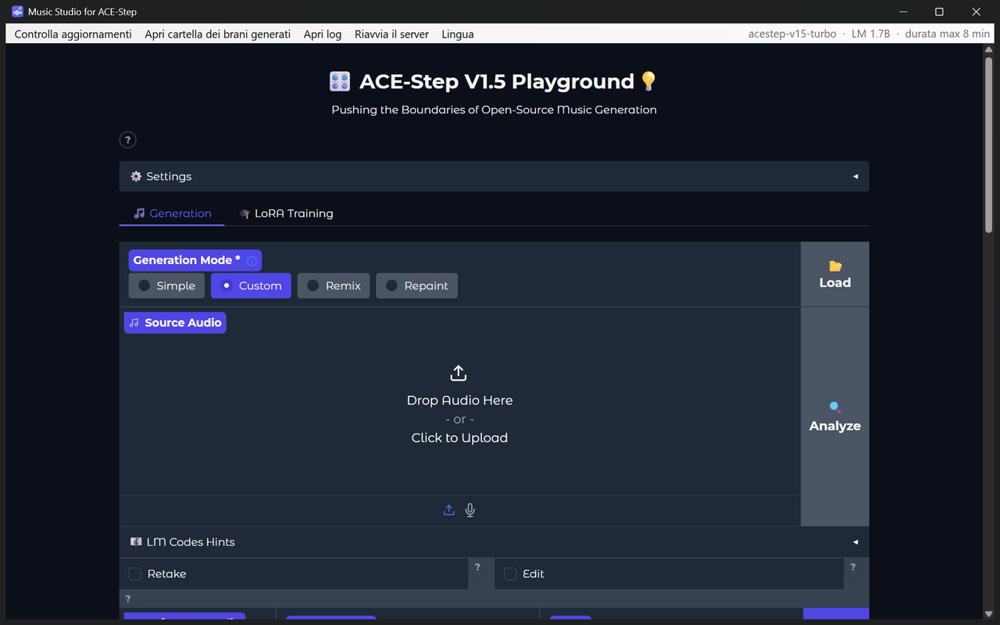

# Music Studio for ACE-Step

[English](README.md) · **Italiano**

Versione **1.1.1**

Una piccola app per Windows che apre l'interfaccia web di [ACE-Step 1.5](https://github.com/ACE-Step/ACE-Step-1.5)
(generazione musicale con IA, open source) in una finestra tutta sua, come un normale programma. Include anche
un **server MCP**, così gli agenti AI (Claude, Codex, Gemini CLI, Cursor, VS Code Copilot, …) possono generare
brani per te direttamente dalla chat: vedi [mcp/README.it.md](mcp/README.it.md).

> [!IMPORTANT]
> **Questa app NON include ACE-Step e senza di esso non funziona.** Prima di usarla è OBBLIGATORIO:
> 1. scaricare il repository ufficiale **[ACE-Step/ACE-Step-1.5](https://github.com/ACE-Step/ACE-Step-1.5)**;
> 2. installarlo seguendo **il suo README** (con `uv`);
> 3. avviarlo **una prima volta** con `uv run acestep` e attendere che abbia finito di scaricare i modelli e che si
>    apra la pagina — il primo avvio può richiedere molto tempo.
>
> Music Studio poi avvia per te quella copia di ACE-Step (e usa la versione nuova ogni volta che ACE-Step viene
> aggiornato).



## Funzioni

- Finestra nativa con schermata di caricamento e log del server in tempo reale (il primo avvio può richiedere tempo).
- Avvia ACE-Step nascosto (senza finestra della console) e lo chiude, con tutti i suoi processi, quando chiudi la
  finestra (Job Object di Windows: non resta nulla in esecuzione nemmeno se l'app si blocca).
- Mostra nella barra del menu il modello caricato e la durata massima dei brani.
- Mentre un brano viene generato (dalla pagina o da un agente AI) una piccola finestra al centro della pagina mostra la
  fase in corso, una barra di avanzamento e il tempo trascorso. ACE-Step non fornisce una percentuale complessiva,
  quindi la barra segue le fasi che scrive nel suo log (solo la decodifica ha una percentuale reale).
- Riconosce un ACE-Step già avviato a mano e si collega a quello senza avviarne un secondo.
- Controlla le nuove versioni di ACE-Step (git) e aggiorna su richiesta, con ripristino automatico se qualcosa va storto.
- Si accorge se ACE-Step è stato aggiornato fuori dall'app e propone di riavviarlo.
- I download dalla pagina funzionano (finestra "Salva con nome"); voce di menu per aprire la cartella dei brani generati.
- Interfaccia in italiano o inglese (segue Windows, oppure scegli dal menu *Lingua*). L'opzione *Come ACE-Step* usa
  la lingua con cui è stato avviato ACE-Step (la sua impostazione `LANGUAGE`): per questo l'app parla anche portoghese,
  giapponese, cinese ed ebraico (traduzioni non fatte da madrelingua: le correzioni sono benvenute).

## Requisiti

- Windows 10/11 (WebView2 è già incluso in Windows 11).
- [ACE-Step 1.5](https://github.com/ACE-Step/ACE-Step-1.5) installato con [uv](https://docs.astral.sh/uv/)
  seguendo il suo README (deve avviarsi con `uv run acestep`). È fortemente consigliata una GPU NVIDIA.
- [git](https://git-scm.com/) (per il controllo degli aggiornamenti) e ffmpeg (`winget install Gyan.FFmpeg`).

## Installazione

**Da una release (il modo più semplice):** scarica lo zip dalla pagina *Releases*, estrailo dove vuoi e avvia
`Music Studio.exe`. Per avere l'icona sul desktop: clic destro su `Music Studio.exe` → *Mostra altre opzioni* →
*Invia a* → *Desktop*.

**Dal codice sorgente:**

```powershell
git clone <questo repository> music-studio-for-acestep
cd music-studio-for-acestep
uv sync
powershell -ExecutionPolicy Bypass -File build.ps1
```

L'eseguibile viene creato in `dist\Music Studio\` e sul desktop compare un collegamento.
Per avviarla senza compilare: `uv run python app.py`.

## Indicare all'app dove si trova ACE-Step

Di predefinito l'app cerca ACE-Step in `%USERPROFILE%\ACE-Step-1.5`. Se è altrove, l'app mostra
*Cartella di ACE-Step non trovata* con il pulsante **Scegli la cartella di ACE-Step…**: seleziona la cartella che
contiene il `pyproject.toml` di ACE-Step. La scelta viene salvata in `config.json`.

## config.json

Si trova accanto a `Music Studio.exe` e viene creato al primo avvio. Chiudi l'app prima di modificarlo.

| Chiave | Predefinito | Significato |
|---|---|---|
| `acestep_path` | `%USERPROFILE%\ACE-Step-1.5` | Cartella di ACE-Step 1.5 (nel JSON usa `\\`) |
| `port` | `7860` | Porta del server di ACE-Step |
| `window_width`, `window_height` | `1280`, `800` | Dimensione iniziale della finestra |
| `language` | `auto` | `auto` (lingua di Windows), `en`, `it` oppure `acestep` (stessa lingua dell'interfaccia di ACE-Step) |
| `enable_api` | `true` | Avvia ACE-Step con `--enable-api` (serve al server MCP; i modelli vengono caricati all'avvio) |
| `skip_version` | `""` | Commit di ACE-Step che hai scelto di saltare; svuotalo per essere avvisato di nuovo |

Cancella il file per tornare ai valori predefiniti.

## Usarla da un agente AI (MCP)

**Music Studio MCP for ACE-Step** (`music-studio-mcp-for-ace-step`) permette a Claude Code, Codex e altri agenti AI
di creare brani per te dalla chat: l'agente chiede quale modalità usare (Simple, Custom, Remix, Repaint), fa qualche
domanda (stile, voce, durata indicativa con il massimo tra parentesi, loop facoltativo, file audio…), mostra un
riepilogo, chiede il nome del file e genera il brano tramite questa app.

1. Lascia `"enable_api": true` in `config.json` (predefinito) e apri l'app.
2. Nella cartella dell'app esegui `uv run mcp\install.py`: trova gli agenti AI installati sul PC e configura quelli
   che scegli.
3. Riavvia gli agenti e chiedi, ad esempio, *"fammi un brano lo-fi di 1 minuto per studiare"*.

> [!TIP]
> **Solo con l'MCP: brani che si ripetono in loop senza stacchi.** Né ACE-Step né l'app lo permettono (ACE-Step
> sfuma alla fine anche quando gli si chiede un loop). Chiedi all'agente un brano "che vada in loop all'infinito" —
> ad esempio musica per videogiochi o di sottofondo — e ricevi un unico file `.wav` la cui fine scorre nell'inizio.

Verificato con **Claude Code** e **Codex**; gli altri agenti (Claude Desktop, Gemini CLI, Copilot, Cursor, …) vengono
configurati con il loro formato documentato e dovrebbero funzionare. Dettagli: [mcp/README.it.md](mcp/README.it.md).

## Log

*Apri log* nel menu apre `logs\server.log` (output di ACE-Step). In `logs\app.log` ci sono gli eventi dell'app,
in `logs\updates.log` lo storico degli aggiornamenti con gli hash dei commit.

## Controllo intelligente delle app di Windows

L'eseguibile non è firmato digitalmente, quindi con il Controllo intelligente delle app attivo Windows molto
probabilmente lo bloccherà ("Un criterio di controllo dell'applicazione ha bloccato il file"). "Sblocca" nelle
proprietà del file non serve. Avvia invece l'app dal codice sorgente — è la stessa app, avviata da Python:

```powershell
git clone <questo repository> music-studio-for-acestep
cd music-studio-for-acestep
powershell -ExecutionPolicy Bypass -File create_shortcut.ps1
```

Lo script prepara l'ambiente Python e mette sul desktop un collegamento **Music Studio for ACE-Step** con l'icona
dell'app (avvia l'app con `pythonw.exe`, senza finestra della console). Non disattivare il Controllo intelligente
delle app.

## Licenza e crediti

MIT, vedi [LICENSE](LICENSE). ACE-Step è sviluppato dal team di ACE-Step ed è distribuito con la sua licenza;
Music Studio for ACE-Step è un progetto indipendente e non ufficiale, non affiliato né approvato dal team di
ACE-Step; il nome "ACE-Step" indica solo il software con cui funziona.
