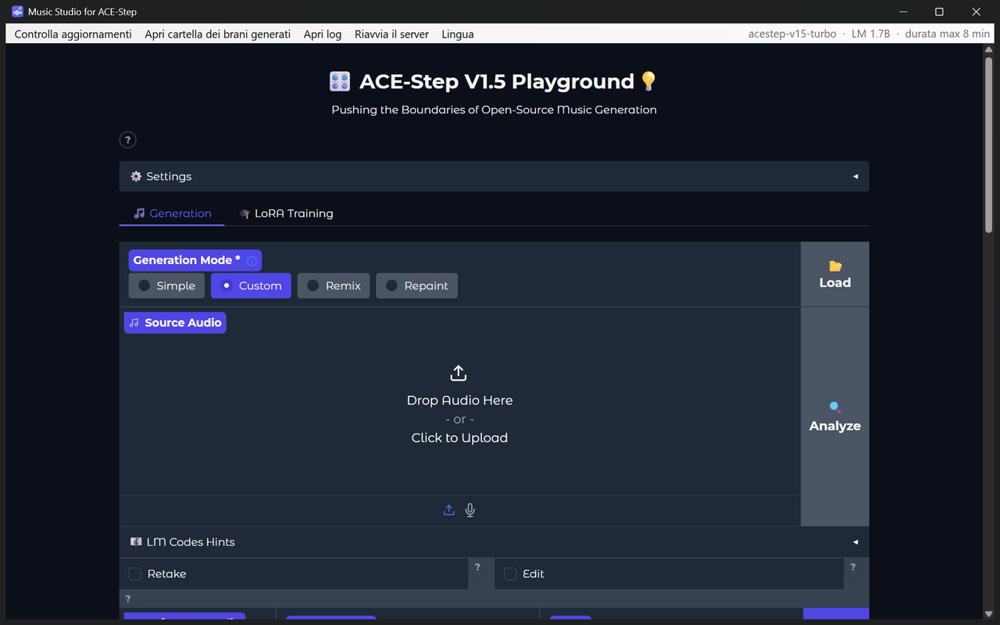

# Music Studio for ACE-Step

**English** · [Italiano](README.it.md)

Version **1.0.0**

A small Windows app that runs the web interface of [ACE-Step 1.5](https://github.com/ACE-Step/ACE-Step-1.5)
(open-source AI music generation) in its own window, as a normal desktop program. It also includes an
**MCP server**, so AI agents (Claude, Codex, Gemini CLI, Cursor, VS Code Copilot, …) can generate songs for you
from a chat: see [mcp/README.md](mcp/README.md).

> [!IMPORTANT]
> **This app does NOT include ACE-Step and does not work without it.** Before using it you MUST:
> 1. download the official repository **[ACE-Step/ACE-Step-1.5](https://github.com/ACE-Step/ACE-Step-1.5)**;
> 2. install it by following **its own README** (with `uv`);
> 3. start it **once** with `uv run acestep` and wait until it has finished downloading the models and the page
>    opens — the first start can take a long time.
>
> Music Studio then starts that copy of ACE-Step for you (and uses the new version whenever ACE-Step is updated).



## Features

- Native window with loading screen and live server log (the first start can take a while).
- Starts ACE-Step hidden (no console window) and stops it, with all its child processes, when you close the
  window (Windows Job Object: nothing is left running even if the app crashes).
- Shows the loaded model and the maximum song length in the menu bar.
- While a song is generated (from the page or from an AI agent) a small window in the middle of the page shows the
  current phase, a progress bar and the elapsed time. ACE-Step does not report an overall percentage, so the bar
  follows the phases it prints in its log (only the decoding step has a real percentage).
- Detects an ACE-Step already started by hand and connects to it without starting a second one.
- Checks for new ACE-Step versions (git) and updates on request, with automatic rollback if something fails.
- Notices when ACE-Step was updated outside the app and offers to restart it.
- Downloads from the page work (Save as dialog); menu item to open the generated songs folder.
- Interface in English or Italian (follows Windows, or choose it from the *Language* menu). The *Same as ACE-Step*
  option uses the language ACE-Step was started with (its `LANGUAGE` setting): the app also speaks Portuguese,
  Japanese, Chinese and Hebrew for this (translations not made by native speakers: corrections welcome).

## Requirements

- Windows 10/11 (WebView2 is already included in Windows 11).
- [ACE-Step 1.5](https://github.com/ACE-Step/ACE-Step-1.5) installed with [uv](https://docs.astral.sh/uv/)
  following its README (it must start with `uv run acestep`). An NVIDIA GPU is strongly recommended.
- [git](https://git-scm.com/) (for update checks) and ffmpeg (`winget install Gyan.FFmpeg`).

## Install

**From a release (simplest):** download the zip from the *Releases* page, extract it anywhere and run
`Music Studio.exe`. To get a desktop icon: right-click `Music Studio.exe` → *Show more options* → *Send to* → *Desktop*.

**From source:**

```powershell
git clone <this repository> music-studio-for-acestep
cd music-studio-for-acestep
uv sync
powershell -ExecutionPolicy Bypass -File build.ps1
```

The executable is created in `dist\Music Studio\` and a shortcut is placed on your desktop.
To run without building: `uv run python app.py`.

## Tell the app where ACE-Step is

By default the app looks for ACE-Step in `%USERPROFILE%\ACE-Step-1.5`. If it is somewhere else, the app shows
*ACE-Step folder not found* with a **Choose the ACE-Step folder…** button: pick the folder that contains
ACE-Step's `pyproject.toml`. The choice is saved in `config.json`.

## config.json

It sits next to `Music Studio.exe` and is created on first start. Close the app before editing it.

| Key | Default | Meaning |
|---|---|---|
| `acestep_path` | `%USERPROFILE%\ACE-Step-1.5` | ACE-Step 1.5 folder (use `\\` in JSON) |
| `port` | `7860` | Port of the ACE-Step server |
| `window_width`, `window_height` | `1280`, `800` | Initial window size |
| `language` | `auto` | `auto` (Windows language), `en`, `it`, or `acestep` (same language as ACE-Step's interface) |
| `enable_api` | `true` | Starts ACE-Step with `--enable-api` (needed by the MCP server; models are loaded at start) |
| `skip_version` | `""` | ACE-Step commit you chose to skip; empty it to be notified again |

Delete the file to go back to the defaults.

## Use it from an AI agent (MCP)

**Music Studio MCP for ACE-Step** (`music-studio-mcp-for-ace-step`) lets Claude Code, Codex and other AI agents
create songs for you from a chat: the agent asks a few questions (style, vocals, approximate length with the
maximum in brackets, optional seamless loop…), shows a summary and generates the song through this app.

1. Keep `"enable_api": true` in `config.json` (default) and open the app.
2. In the app folder run `uv run mcp\install.py`: it finds the AI agents installed on the PC and configures the ones
   you choose.
3. Restart the agents and ask, e.g. *"make me a 1-minute lo-fi track to study with"*.

Verified with **Claude Code** and **Codex**; other agents (Claude Desktop, Gemini CLI, Copilot, Cursor, …) are
configured with their documented format and should work. Details: [mcp/README.md](mcp/README.md).

## Logs

*Open log* in the menu opens `logs\server.log` (ACE-Step output). `logs\app.log` has the app events,
`logs\updates.log` the update history with commit hashes.

## Windows Smart App Control

The executable is not code-signed, so with Smart App Control turned on Windows will most likely block it
after download ("An app control policy blocked this file"). In that case run the app from source:
`uv run python app.py` (or build it yourself with `build.ps1`). Do not turn Smart App Control off for this.

## License and credits

MIT, see [LICENSE](LICENSE). ACE-Step is developed by the ACE-Step team and released under its own
license. Music Studio for ACE-Step is an independent, unofficial project and is not affiliated with or
endorsed by the ACE-Step team; "ACE-Step" is used only to say which software it works with.
